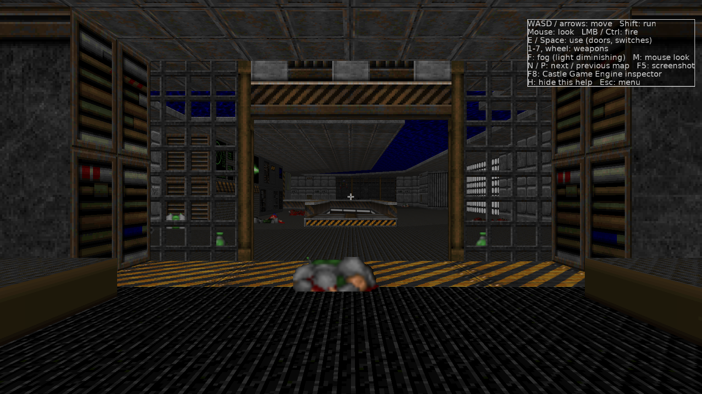
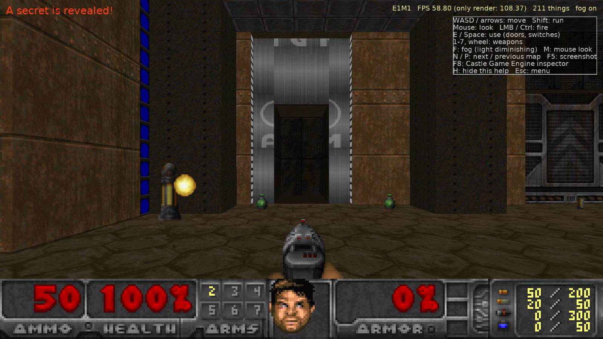
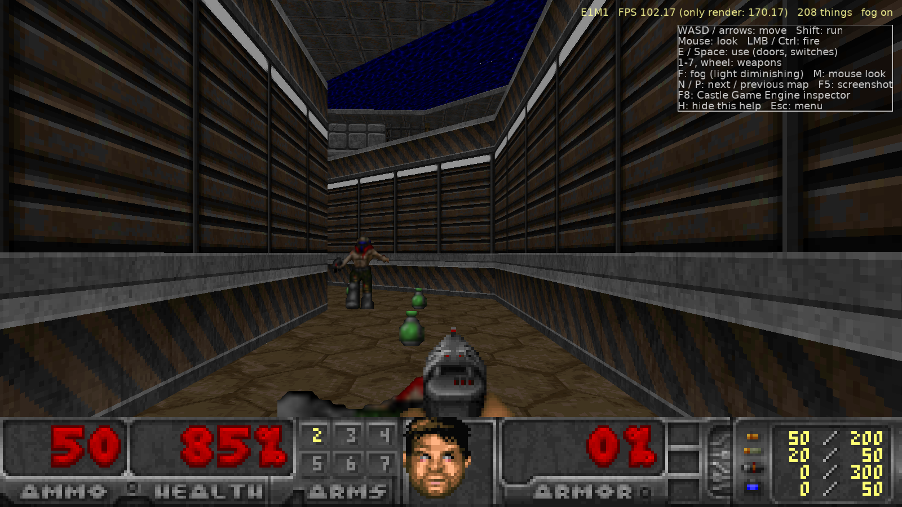
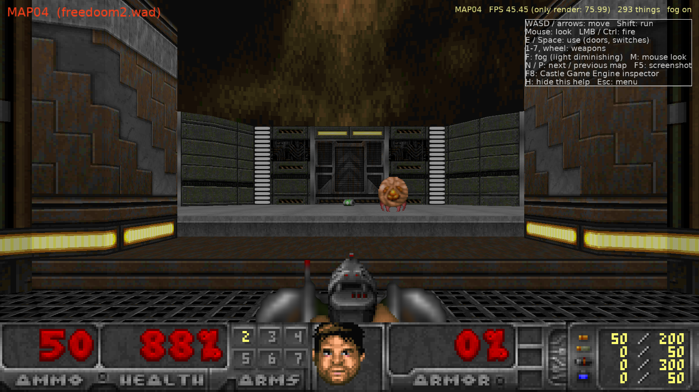
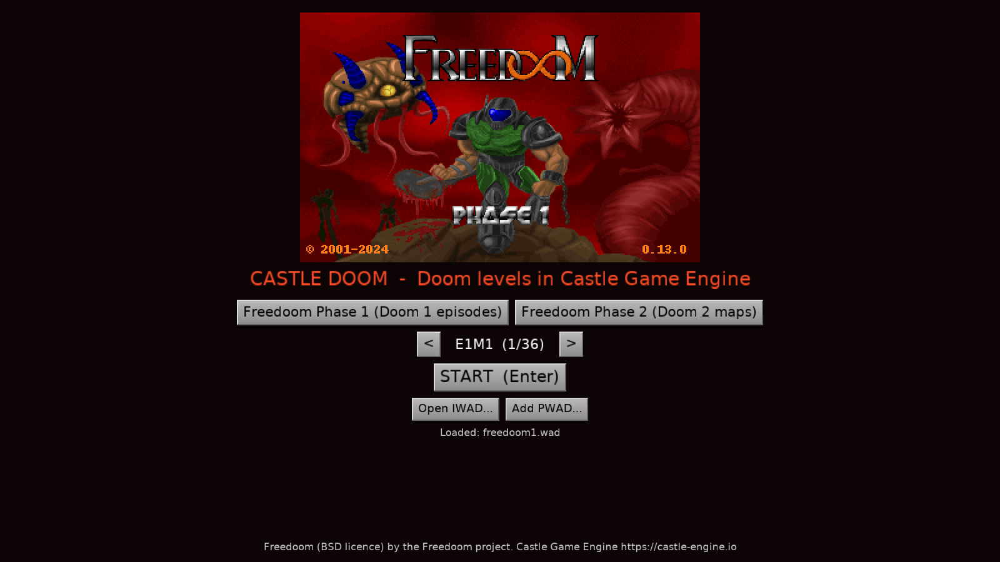

# Castle DOOM

[](https://github.com/mariuz/castle-doom/actions/workflows/build.yml)
[](https://github.com/mariuz/castle-doom/actions/workflows/web.yml)

**Play in the browser: https://mariuz.github.io/castle-doom/** (WebAssembly build; it plays
offline after one visit and can be installed as an app from the browser's menu)
&middot; **Downloads: [Releases](https://github.com/mariuz/castle-doom/releases)** (Windows installer or zip, Linux, macOS, Android APK) &middot; [Changelog](docs/CHANGELOG.md)

Doom levels, rendered and played with [Castle Game Engine](https://castle-engine.io/)
(Object Pascal). It reads the original WAD format directly: Freedoom Phase 1 and
Phase 2 (BSD licensed, bundled in `data/wads/`) work out of the box, and your own
vanilla-format Doom 1 / Doom 2 IWADs and PWADs can be loaded from the menu
("Open IWAD...", "Add PWAD...") or the command line:

```bash
castle-doom -iwad DOOM2.WAD -file mymap.wad -deh mymap.deh -warp MAP01
castle-doom -random 42                       # eight generated maps from seed 42
castle-doom -random 42 --random-wad r42.wad  # ...written as a PWAD for other ports
castle-doom --record e1m1.cdemo              # record the level you play
castle-doom --playdemo e1m1.cdemo            # play it back (it says if it stayed in sync)
```

This project is deliberately written as a *tour of the engine*: every Doom subsystem
is mapped onto a Castle Game Engine feature.



| | |
|---|---|
|  |  |
|  |  |

| Doom | Castle Game Engine |
|---|---|
| WAD lumps (`VERTEXES`, `LINEDEFS`, `SECTORS`, BSP `NODES`...) | `DoomWad` / `DoomMap` units, plain Pascal records |
| Walls, floors, ceilings | X3D nodes built in code: `TIndexedTriangleSetNode`, `TUnlitMaterialNode`, per-vertex `TColorNode` for sector light, one `TCastleScene` per movable sector |
| Textures (`TEXTURE1` + `PNAMES` patch composition, flats, sprites) | decoded to `TRGBAlphaImage`, served through a custom URL protocol `doomgfx:/tex/STARTAN3.png` (`RegisterUrlProtocol`) so the engine's texture cache shares them between scenes |
| Animated flats/walls (NUKAGE, BFALL...) | `TImageTextureNode.SetUrl` swapped every 8 tics |
| Sky | a textured cylinder scene that follows the camera |
| Light diminishing | Doom's colormap arithmetic as a GLSL shader effect (`TEffectNode`, a `FloatVertexAttribute` with the sector light) that looks each pixel up in the real `PLAYPAL` / `COLORMAP` (exact colours and banding), with the gun flash light, invulnerability and light amplification colormaps (toggle with `F`) |
| Player | `TCastleWalkNavigation`: gravity, `PreferredHeight` 41, `ClimbHeight` 24 (stairs), `Radius`, mouse look, head bobbing; collisions via `PreciseCollisions` on the map scenes |
| Things / monsters | one `TCastleTransform` per thing with a `TCastleBillboard` behavior and a quad `TCastleScene`; sprite rotations picked like `R_ProjectSprite` |
| Shooting | Doom's autoaim (`P_AimLineAttack`) and line attacks traced in Doom units against linedefs and thing boxes |
| Doors, lifts, floors, ceilings, stairs, crushers | sector height changes regenerate the affected `TCastleScene` coordinates in place |
| Sounds (`DS*` DMX lumps) | converted to WAV on the fly via `doomsfx:/DSPISTOL` URL protocol, positional audio with `TCastleSoundSource` |
| Music (`D_*` MUS or MIDI lumps + `GENMIDI` OPL patches) | `DoomMusic` programs Nuked OPL3 (a shared library loaded by `DoomOpl3`; a built-in FM model otherwise) with the GENMIDI registers and renders the song to WAV (`doommus:/D_E1M1.wav`), looped on `SoundEngine.LoopingChannel[0]` |
| Status bar | `STBAR` + digit patches composed into one image shown by a pixel-perfect `TCastleImageControl` |
| Weapon sprites, flashes, screen flashes, messages | `TCastleImageControl`, `TCastleRectangleControl`, `TCastleLabel` |
| Title / intermission | `TCastleView`s |

**Read [docs/ARCHITECTURE.md](docs/ARCHITECTURE.md)** for a unit-by-unit explanation of how
the port works and which engine APIs each part uses; [docs/ROADMAP.md](docs/ROADMAP.md) lists
what is still missing, prioritized; [CLAUDE.md](CLAUDE.md) has build, test and contribution notes.

## What works

- Freedoom Phase 1 (36 ExMy maps) and Phase 2 (32 MAPxx maps), map selection in the menu.
- Random maps: New Game -> "Random maps" (or `-random [SEED]`, `?random=SEED` in the browser)
  generates eight levels from a seed: rooms split from a rectangle (the splits are the BSP),
  connected by openings, doors and stairs (a locked door guards the exit from the second map
  on, its key before it), with windows, secret closets, lights, nukage and sky rooms, monsters and supplies that grow
  with the map number, an exit switch in the farthest room and names in a UMAPINFO. The same
  seed gives the same maps, saves keep it, and `--random-wad FILE` writes the PWAD.
- Textured walls with Doom's pegging rules and offsets, masked middle textures (grates),
  floors and ceilings from BSP subsectors, sky, sector light levels with "fake contrast".
- Doors (manual, switch, walk-over, locked, blazing), lifts (perpetual ones stop and
  resume), floors (raise to the shortest lower texture, donuts), ceilings, crushers
  (slow ones slow down on what they crush, silent ones, stop and resume), stairs, teleporters, light changes, scrolling walls (and Boom's scrolling floors and ceilings and carrying conveyor floors), switch textures, secret sectors,
  damaging floors, exits (normal and secret) with an intermission screen.
- Pickups: health, armor, ammo, keys, weapons, powerups, with Doom's messages.
- Monsters wake up like in Doom: on sight in front of them, or when your shots reach their
  sector (sound spreads through open doors, stops at closed ones and crosses at most one sound-blocking
  line; ambush monsters must also see you). They chase (2D Doom-style movement with step/drop-off
  rules, they open doors and use teleporters and monster-only teleport lines; spectres are
  drawn as Doom's speckled `fuzzoffset` fuzz; flyers rise and sink towards you like Doom's `P_ZMovement`
  and their corpses fall), attack with melee, hitscan or projectiles, take pain, die
  (or burst into gibs when overkilled), get knocked back by hits and explosions (so do you),
  are squashed to gibs as corpses under closing doors and crushers, drop items, and fight each other when hit by another monster (infighting). Lost souls
  charge, Pain Elementals spit lost souls (three more when they die), Arch-viles raise
  the dead and burn you with their fire attack. Barrels explode with splash damage. Boss deaths trigger the special map events (E1M8, E2M8,
  E3M8, E4M6, E4M8, MAP07, Commander Keen). The Icon of Sin on MAP30 spits cubes that
  spawn monsters and dies to rockets through the hole in its wall.
- Weapons: fist, chainsaw, pistol, shotgun, super shotgun, chaingun, and real projectiles
  for the rocket launcher (splash damage), plasma gun and BFG (charge, ball, tracer spray).
  Punches and the chainsaw turn you towards what they hit, like in Doom.
- Status bar with face, keys, arms, ammo table; weapon bobbing, weapons lowered and raised
  when switching; damage, pickup and radiation-suit tints from the WAD's palettes; Doom's
  screen melt between levels.
- Automap (Tab) with Doom's line colours, player arrow, zoom, grid and a reveal-all cheat.
- Doom's text font for messages, and the real intermission screen (level names, FINISHED,
  animated kills/items/secrets/time with sounds, par times, ENTERING), with the episode
  maps' animations, visited-level splats and blinking "you are here" pointer (ZDoom's
  intermission scripts; Freedoom's own maps leave them blank).
- Freedoom's own wording from the WAD's `DEHACKED` strings: pickup and door messages, level
  titles (also on the automap), the Nightmare and quit questions.
- Finales: Freedoom's story texts (read from the WAD's `DEHACKED` strings), the end
  pictures, the bunny scroller after E3M8 and the Doom 2 cast call after MAP30.
- Doom's own menu from the WAD's graphics: the title pages cycle (TITLEPIC, CREDIT, HELP2)
  until a key opens the menu; New Game, episode and skill select (all five skills, with
  Nightmare's fast monsters and respawning), Load Game, Read This! (`F1`); `-skill 1..5`.
  In the game, Esc / F2 / F3 / F4 open Doom's main menu, save and load pages and the sound
  volume page (`M_*` graphics, thermometer sliders) over the paused game; saves get a typed
  name (Doom's `_` cursor; the map, kills and time by default).
  The Options page picks WADs, map and skill, and the video options: field of view
  (Doom's 90 by default), UI scale for the text and panels, fullscreen, v-sync and a frame
  rate cap on the desktop and,
  in the browser, the render resolution (25-100% of the canvas' pixels, for slow machines).
- Demos: `--record FILE` (or Options -> Record demo...) records a game level after level (from
  its start or a loaded game) as the world received it and `--playdemo FILE` (Play demo...)
  plays it back on its own random numbers, so it plays the
  same at any frame rate; a checksum every second says where a playback went out of sync.
- Dynamic lights (Options -> Video, off by default): rockets, fireballs, plasma, BFG balls,
  explosions and muzzle flashes light the walls and sprites around them in their colour.
- Photo mode: `O` pauses the game, hides the HUD and lets the camera fly through the level (`F5`
  saves a screenshot without the HUD; `O` or Esc returns to the player).
- Closed captions: Options -> Sound Volume -> Captions (or F4) shows a line for each sound heard ("Door opens, ahead",
  "Serpentipede sees you, left") under the messages.
- Gamma correction: `F11` (or Options -> Brightness) brightens the dark parts in Doom's five
  steps, remembered in the settings.
- Level statistics: `L` shows kills, items, secrets and the level time above the status bar,
  and every level's best time (per WADs and skill) is kept and shown on the intermission
  ("NEW BEST TIME!").
- Save and load: F2 / F3 slot menus, F6 / F9 quick save / load, "Continue (quick save)" on
  the title screen, `-loadgame N`. Everything is saved: open doors, moving lifts, used
  switches, corpses, monsters mid-fight, inventory and the automap. In the browser saves
  are kept in the page's `localStorage`, so they survive reloads; the home page's "Your
  saves" section exports them to a file and imports them back, and the desktop build reads
  the same file (Options: Export / Import saves, `--export-saves` / `--import-saves`).
- External IWADs and PWADs (menu file dialogs or `-iwad` / `-file` / `-deh` / `-warp`), PWAD lumps
  overriding the IWAD's like in Doom; vanilla and ZDoom extended nodes (`XNOD`, `ZNOD`,
  `XGLN`/`ZGLN`, `XGL2`/`ZGL2`, `XGL3`/`ZGL3`) and glBSP GL nodes (V1, V2, V3, V5, also from
  a `.gwa` file), so maps built with ZDBSP or glBSP load too. Boom's generalized linedef
  types (floors, ceilings, doors, locked doors, lifts, stairs and crushers), its numbered
  extra line types (silent teleports among them), sector types (damage and secret bits),
  ice and mud, wind, currents and point pushers, translucent middle textures and things (MBF's DeHackEd bit), elevators, line-to-line
  teleports, light and sky transfers (each sky sector its own sky), scrollers driven by moving
  sectors, MBF's slower monsters in mud, deep water
  (pools drawn at another sector's heights, tinted under the surface), `ANIMATED` and
  `SWITCHES` lumps give PWADs their own animated textures and switches, and a `UMAPINFO`
  lump (or ZDoom's `MAPINFO` / `ZMAPINFO`, old or new syntax: maps, clusters, episodes) their
  level names, music, skies, par times, map order, story texts, intermission pictures and
  endings; ZDoom's `LANGUAGE` lumps give the strings those name (and replace the game's own
  messages and texts like BEX strings).
- Music: MUS and MIDI lumps played on an emulated OPL3 (Nuked OPL3, loaded as a shared
  library packaged with the game) driven by the WAD's GENMIDI instrument bank, the AdLib /
  Sound Blaster sound of the original; a built-in FM model plays when the library is
  missing and in the browser. Title, level and intermission tracks.

## Not (yet) done

See [docs/ROADMAP.md](docs/ROADMAP.md). Headlines: no UDMF maps,
DeHackEd patches cannot rename sprites or sounds (BEX `[SPRITES]` / `[SOUNDS]`),
the browser's music is the approximate FM model (no OPL3 emulator there).

## Build and run

Install Castle Game Engine 7 (its Windows download bundles Free Pascal), then
(on Windows, copy `OpenAL32.dll` and `wrap_oal.dll` from the engine's `bin/` next to the
executable for sound; `castle-engine package` does that automatically):

```bash
castle-engine compile --mode=release
castle-engine run
```

or open `CastleEngineManifest.xml` in the Castle Game Engine editor.

Keys: `WASD`/arrows move, `Shift` run, mouse look, left mouse / `Ctrl` fire,
`E`/`Space` use, `1`-`7` and mouse wheel weapons, `F` light diminishing, `M` mouse look on/off,
`J` music on/off, `F4` sound / music volume, `Tab` automap (`+`/`-`/wheel zoom, `G` grid, `I` reveal all),
`F2`/`F3` save/load menu, `F6`/`F9` quick save/load, `L` level statistics, `F11` gamma correction (5 levels, also Options -> Brightness), `O` photo mode, `N`/`P` next/previous map,
`F5` screenshot, `F8` the engine's inspector (the map, every thing and the game state by name; its `F9` selects the monster under the crosshair), `H` help, `Esc` Doom's menu over the paused game
(Options: end game, messages, mouse sensitivity, sound volume and captions, video, brightness; `Esc` again or a click beside
the items resumes; in the browser, Esc releasing the mouse opens it the same way, and a
"click to look around" prompt shows until a click captures the mouse again). These are the
default keys: the title screen's Options -> Controls... rebinds moving, turning, running,
firing, using and the automap, the weapon keys and next / previous weapon, and the hotkeys
from light diminishing to quick save / load (two keys and a mouse button or wheel direction
each, on three pages, saved in `settings.json`; the help panel shows the new bindings). The
left button fires and the wheel changes weapons until rebound; Esc, F1-F4 and F8 stay fixed.

Gamepad (Windows, Linux and the browser, where the pad shows up after a button press):
left stick move / strafe, right stick turn / look, right trigger fire, A / X use,
LB / RB previous / next weapon, View automap, Menu Doom's menu; in menus the D-pad, A (Enter)
and B (back). Options -> Controls... -> Gamepad rebinds fire, use, the automap and the
weapon changes (two buttons each, the triggers too).

Android: the Releases page has an APK for 64-bit ARM phones and tablets (Android 5.0 or
newer; allow installing from your browser or file manager). It carries both Freedoom WADs,
the touch controls are always on (a gamepad works too) and the back button opens Doom's
menu; music plays on the built-in FM synthesizer. Until the project has release signing
keys the APK is signed with a build's debug key: uninstall the old version before
installing a newer one (your saves go with it).

Touch screens (phones and tablets in the browser and on Android; `--touch` on the desktop, where the
mouse is one finger): a stick appears where the left thumb lands (pushed to its edge it
runs), dragging anywhere else on the right turns and looks, and round buttons fire (drag
the fire button to aim while shooting), use, change weapons, toggle the automap and open
the menu. The controls show when a finger touches the screen and hide again when the
mouse is used; taps work as clicks in the menus and on the intermission. Options ->
Controls... -> Touch mirrors them for the left hand (the stick on the right), makes them
75 to 150% as large and 25 to 100% opaque, and its Edit... lets you drag each button where
your thumbs want it.

Automated smoke test (loads a map, runs a script, saves screenshots, quits):

```bash
castle-doom --autotest E1M1 shots/e1m1 --demo "S,F:3,S,T:90,U,W:2,S,X,S,Q"
```

## Continuous integration

- `.github/workflows/build.yml`: packages Windows x86_64, Linux x86_64 and macOS
  app bundles (x86_64 and aarch64, unsigned: right-click > Open the first time) on every
  push, each on GitHub's runner for that system with FPC and the CGE snapshot set up by
  [castle-build-ci](https://github.com/castle-engine/castle-build-ci), and a Windows installer (MSI, WiX on a Windows runner, from the Windows zip
  by `tools/make_msi_wxs.py`); pushing a tag `vX.Y.Z`, or running the workflow by hand with
  `release_tag`, attaches them to a GitHub Release. The same workflow builds an Android APK
  (64-bit ARM) in CGE's Docker image, which has the Android SDK, NDK and FPC's Android
  cross-compilers; it is release-signed when the repository has the secrets
  `ANDROID_KEYSTORE_BASE64`, `ANDROID_KEY_ALIAS`, `ANDROID_KEYSTORE_PASSWORD` and
  `ANDROID_KEY_PASSWORD`, else debug-signed.
- The `Autotests` job runs the FPCUnit unit tests (`tests/castle_doom_tests.lpr`: WADs, map
  BSP, music rendering, DeHackEd) and then `tools/run_autotests.py` under Xvfb.
- `.github/workflows/web.yml`: builds the WebAssembly version (FPC main branch with the
  wasm32 cross-compiler and Pas2js are built from source and cached, since the Docker image
  does not ship them yet) and deploys `pages/` + the game to GitHub Pages.

## Source layout

```
code/doomwad.pas        WAD directory and palette
code/doomgraphics.pas   patches, textures, flats, sprites, animations, doomgfx: protocol
code/doommap.pas        map lumps, BSP queries, subsector polygons
code/doomgeometry.pas   map -> X3D scenes (chunks that can be regenerated)
code/doomthings.pas     thing type table (info.c reduced)
code/doomactors.pas     sprite billboards with frame animation
code/doomworld.pas      game logic: movers, specials, pickups, AI, weapons
code/doomsound.pas      DMX -> WAV, doomsfx: protocol
code/doommusic.pas      MUS/MIDI parsing, GENMIDI -> OPL3 registers or the FM model, doommus: protocol
code/doomopl3.pas       Nuked OPL3 loaded as a shared library (data/lib)
code/doomhud.pas        status bar composition
code/doomautomap.pas    automap (DrawPrimitive2D)
code/doomfont.pas       STCFN text
code/doomintermission.pas  intermission screen
code/doomfinale.pas     finale text, end pictures, bunny scroller, cast call
code/doomstates.pas     vanilla's state table (frames, code pointers) and thing rows, generated by tools/make_states.py
code/doomdehacked.pas   DeHackEd patches: BEX strings, things, frames, code pointers, ammo, par times
code/doomwipe.pas       the screen melt
code/doommenu.pas       Doom's menu (M_* graphics): title pages, main, episode, skill, load / save, Read This
code/gameviewmenu.pas   title screen: Doom menu and options
code/gameviewplay.pas   viewport, navigation, input; the 2D layer comes from data/play.castle-user-interface
code/doomworldstatus.pas  the game's state as published properties (the inspector)
data/play.castle-user-interface  the play view's HUD, texts and screens: a CGE editor design
data/menu.castle-user-interface  the title screen, Doom's menu and the Options panel: a CGE editor design
code/doommaptransform.pas  TDoomMapTransform: a Doom level built from a WAD inside a design ("Doom Map" in the editor)
code/gameviewdesign.pas  --autotest MAPCOMPONENT: shows data/mapcomponent.castle-user-interface, a design with that component
```

Freedoom is Copyright (c) 2001-2024 Contributors to the Freedoom project, BSD licence
(see `data/wads/COPYING.txt`). Castle Game Engine is LGPL with static linking exception.
The music's OPL3 emulator is [Nuked OPL3](https://github.com/nukeykt/Nuked-OPL3) by
Nuke.YKT, LGPL 2.1 or later: it is not part of this repository but built by
`tools/build_nuked_opl3.sh` into `data/lib/` (CI does this for the packages, with the
licence text next to it) as a shared library the game loads at runtime, so you can
replace it with your own build, or delete it to get the built-in FM synthesizer.
